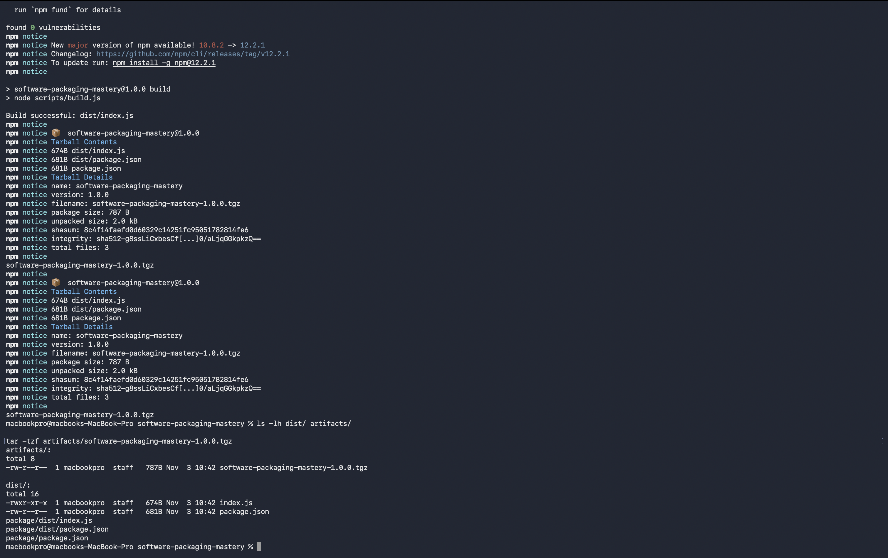
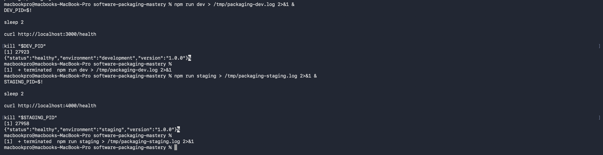
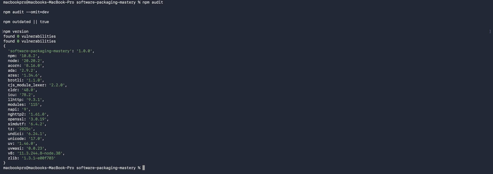

# Software Packaging in Popular Frameworks

## Overview
Node.js and Express.js project demonstrating dependency management, automated builds, semantic versioning, environment configuration, npm packaging, and security auditing.

## Installation
```bash
npm ci
```

## Build and Packaging
```bash
npm run build
npm pack --pack-destination artifacts
```

Generated artifact: `artifacts/software-packaging-mastery-1.0.0.tgz`

## Environment Verification
Development: `npm run dev` (port 3000).
Staging: `npm run staging` (port 4000).
Environment settings use `NODE_ENV` and `PORT`; see `.env.example`.

## Dependencies
Dependencies are declared in `package.json` and locked using `package-lock.json`.
Use `npm ci` for reproducible installation and `npm outdated` to check available updates.

## Semantic Versioning
Initial release: `1.0.0`.
MAJOR: breaking changes; MINOR: backward-compatible features; PATCH: backward-compatible fixes.

## Security Audit
Command: `npm audit --omit=dev`.
Result: 0 vulnerabilities found.

## Evidence




## Author
GitHub: https://github.com/ifobook

## Automated Testing

Run `npm test` to execute the automated API tests.

The test suite validates:
- Application metadata endpoint
- Health-check endpoint
- HTTP 404 responses

## Artifact Integrity Verification

Generate the checksum using:

`shasum -a 256 artifacts/software-packaging-mastery-1.0.0.tgz > artifacts/SHA256SUMS`

Verify integrity using `npm run integrity`.

## Release Management

- Version: 1.0.0
- Git release tag: v1.0.0
- Release history: [CHANGELOG.md](CHANGELOG.md)

## Build and Validation Logs

- [Build log](docs/logs/build.log)
- [Automated tests](docs/logs/tests.log)
- [Integrity verification](docs/logs/integrity.log)
- [Security audit](docs/logs/security-audit.log)

## Submission Checklist

- [x] Dependency configuration
- [x] Automated build
- [x] Distributable npm package
- [x] Development and staging verification
- [x] Automated tests
- [x] SHA256 integrity verification
- [x] Semantic versioning and changelog
- [x] Security audit
- [x] Build and validation logs
